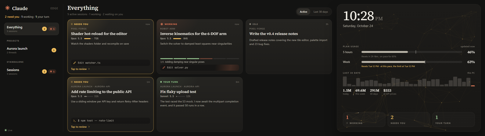
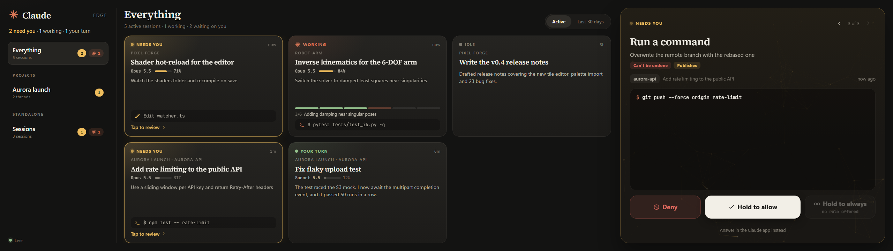
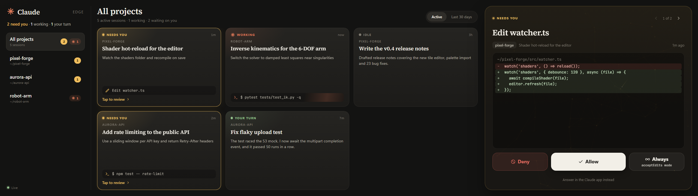
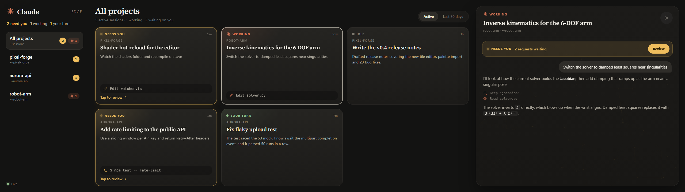

# Claude Edge

A touch dashboard for [Claude Code](https://code.claude.com). Watch your sessions across projects and **approve or deny permission requests from a second screen**, without switching windows.

It's designed for the 2560×720 **Corsair Xeneon Edge**, but it runs in any browser window at any size.



> Unofficial community project. Not affiliated with or endorsed by Anthropic or Corsair.

## Features

- **Approve from the dashboard.** Permission requests appear with a plain-language title, the full command or a red/green diff, and big **Deny / Allow / Always** buttons. **Always** shows the exact rule it will save.
- **Every session at a glance.** Sessions are grouped by project, with live status (*Working*, *Needs you*, *Your turn*, *Idle*), the model, how full the context is, plan progress from Claude's to-do list, the current tool step and the latest message.
- **Plan usage.** Your 5-hour and weekly limits, with reset times and a pace marker that shows whether you're on track to hit them. Below that, 30 days of token use and what it would have cost at API prices.
- **A hold for risky commands.** Force pushes, `rm -rf`, dropping tables and the like need a press-and-hold to allow. Requests are also labelled when they publish, use the network or touch files outside the project.
- **Follow a thread.** Tap a session to watch the conversation and its tool steps live.
- **Built for touch and distance.** Large targets, high contrast, and a layout that scales with the screen's height, so it looks the same at any Windows display scaling.
- **Ambient mode.** When nothing needs you, the right panel shows a clock over a quiet neural-network animation. It changes color and pace with what Claude is doing.
- **Zero dependencies.** One small Node server and one HTML file.

| Approving a command | Reviewing an edit | Following a thread |
| --- | --- | --- |
|  |  |  |

## How it works

```
Claude Code ──HTTP hooks──▶ server.js (127.0.0.1) ──SSE──▶ dashboard (browser / Xeneon Edge)
           ◀── decision ───            ◀── tap ────
```

- `install-hooks.js` adds [HTTP hooks](https://code.claude.com/docs/en/hooks) to `~/.claude/settings.json`: session start/end, prompts, tool use, notifications, stop, and **PermissionRequest**.
- The server holds each `PermissionRequest` open until you tap a button, then answers with the hook's `allow` / `deny` decision.
- In the Claude desktop app, the normal in-app prompt shows at the same time. **Whichever you answer first wins**, and the dashboard clears the request if you answered in the app.
- Session titles come from the desktop app's session metadata and from Claude Code's own titles in the transcripts in `~/.claude/projects`, which also hold the thread history, model, context and token use.
- It also sets a [status line](https://code.claude.com/docs/en/statusline). Claude Code hands the status line your plan's usage limits; ours forwards them to the dashboard and then prints whatever status line you had before. Only terminal sessions run a status line, so limits appear once one is running.
- If the server isn't running, the hooks fail fast and Claude Code carries on as normal.

## Requirements

- Node.js 18 or newer
- A recent Claude Code version with HTTP hook support (the desktop app's Code tab or the CLI)
- Windows for the one-step launcher (`start-edge.ps1`). The server and hooks also run on macOS and Linux; open the dashboard URL in any browser.

## Setup

```powershell
git clone https://github.com/danmartinez78/claude-edge
cd claude-edge
node install-hooks.js        # adds the hooks (backs up settings.json first)
.\start-edge.ps1 -Startup    # starts the server, opens the dashboard on the Edge, runs at login
```

`start-edge.ps1` finds the 2560×720 display and opens a frameless full-screen window there. Without one, it opens a regular window.

On macOS or Linux:

```sh
node install-hooks.js
npm start                    # prints the dashboard URL, including your access token
```

### Sessions on other machines

Claude Code sessions on other computers on your network (Linux boxes, robots, GPU servers) can report to the same dashboard:

```sh
node add-machine.js thor dev@192.168.1.50   # <label> <ssh target>; needs python3 on the remote
```

This picks this PC's LAN address and adds it to the server's listen list, creates a token for that machine, installs the hooks there over SSH, and checks the machine can reach the dashboard. It also installs a small reporter (`edge_report.py`, next to that machine's `settings.json`) that sends each session's title, model, context and plan from its transcript, and forwards its status line. Use `--print` instead of an SSH target to get a command you can paste on the machine yourself. Restart the server afterwards so it listens on the LAN. On Windows, allow the port through the firewall once, from an admin PowerShell:

```powershell
New-NetFirewallRule -DisplayName "Claude Edge dashboard" -Direction Inbound -Protocol TCP -LocalPort 47821 -RemoteAddress LocalSubnet -Profile Private -Action Allow
```

Cards from other machines are labelled with the machine's name. Their thread view is built from hook events (your prompts, tool steps and Claude's replies), because their transcripts stay on that machine. `node add-machine.js thor dev@192.168.1.50 --uninstall` removes them again.

Each machine's token can only send events. It can't read the dashboard or approve anything, so a token sniffed from the plain-HTTP LAN traffic can't be used to approve or deny requests.

### claude.ai Projects

Threads started from a claude.ai Project are grouped under that Project on the rail; everything else is listed under **Standalone** by its session title. The dashboard recognizes a Project thread from the messages the Project wraps around its prompts (relayed tasks and mentions), and groups threads by Project.

Those messages don't carry the Project's name, so an unlabelled Project is named after the repo most of its threads work in. To name it properly, add this to your Project's instructions:

```text
Whenever you write a note for a thread, start it with [project: GO2 Embodied AI] [thread: <the thread's title>].
```

Use your Project's name. Threads are titled with the title Claude Code gives the session; the `[thread:]` label is a fallback. The labels are removed from what the dashboard displays.

### Try it without Claude Code

```sh
npm run demo                 # made-up sessions and approvals on port 47822
```

### Uninstall

```sh
node install-hooks.js --uninstall    # also restores your previous status line
```

On Windows, also delete `Claude Edge.lnk` from your Startup folder (`shell:startup`).

## Security

- The server listens on `127.0.0.1` only, unless you add another machine (then also on your LAN address).
- Every API call needs a random token stored in `~/.claude-edge/config.json`. The launcher passes it in the URL fragment, so it never reaches server logs.
- Requests with a foreign `Origin` or `Host` header are rejected, which blocks other websites and DNS rebinding.
- "Always allow" only saves the rule that Claude Code itself suggested for that request.

## Caveats

- Live status starts once the hooks are installed. Older sessions show as *Idle* until they're used again.
- In the terminal CLI, the in-terminal prompt may wait for the dashboard hook (up to 10 minutes). Tap **Answer in the Claude app instead** to release it.
- Cloud sessions and claude.ai chats run on Anthropic's servers and can't reach a dashboard on your network, so they don't appear here.

## License

[MIT](LICENSE)
